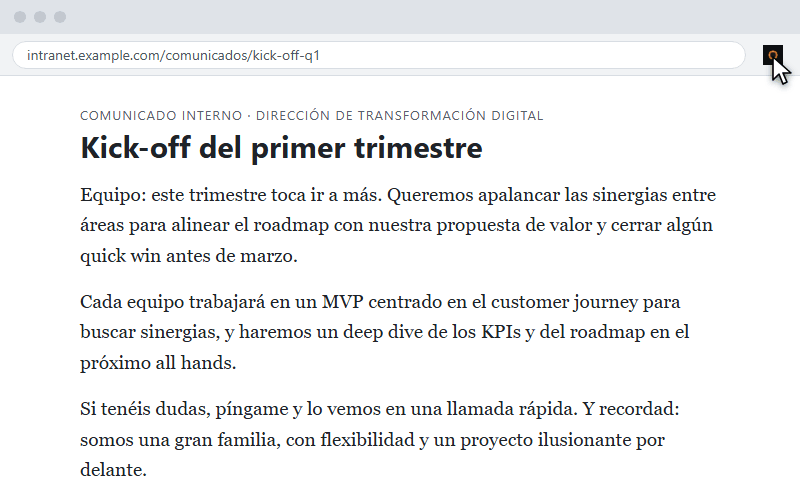

# Detector de Buzzwords 🔎🚭

Extensión de Chrome (Manifest V3) que **resalta la jerga corporativa** de cualquier página —español *e* inglés— y al pasar el ratón te da la **traducción doble**: la real y la sarcasta.

> *"Buscamos sinergias para apalancar el roadmap"* → **colaboración** — «magia que ocurre cuando dos jefes coinciden»

<p align="center"></p>

## 🛡️ Privacidad de verdad

- **Cero permisos de host y cero rastreo.** No hay cuentas, ni cookies, ni analítica, ni datos personales. Lo único que puede descargar es el **catálogo de términos** (un JSON público) desde GitHub al pulsar el icono — sin datos tuyos dentro de la petición. Sin conexión o si la página lo bloquea, usa el catálogo empaquetado en la extensión.
- **`activeTab`: no toca ninguna página hasta que tú pulsas el icono.** Ni contenido en segundo plano, ni historial.
- No recopila nada porque no hay nada que recopilar. Detalle completo en la [política de privacidad](PRIVACY.md).

## 🔄 Catálogo actualizable sin tocar la extensión

El diccionario vive en [`data/diccionario.json`](data/diccionario.json). Al escanear, la extensión intenta cargar la última versión desde este repo y, si no puede, usa la empaquetada en el build. **Añadir términos = editar el JSON y hacer merge**: todos los usuarios lo reciben al instante, sin republicar en la tienda. El JSON remoto se valida antes de usarse (estructura y regex compilables), con suelo mínimo de entradas para que una edición desastrosa nunca deje a nadie sin detector.

## Cómo funciona

```
┌────────────────────── Chrome ──────────────────────┐
│ Clic icono → popup                                  │
│   └─ chrome.scripting.executeScript (activeTab)     │
│        └─ content.js (mundo aislado):               │
│             · catálogo: JSON del repo (remoto)      │
│               con fallback al empaquetado           │
│             · regex unicode sobre 220+ términos     │
│             · TreeWalker sobre nodos de texto       │
│             · <span> con tooltip CSS puro           │
│        └─ devuelve stats → popup pinta el           │
│           Índice de Humo + top jerga + badge        │
└─────────────────────────────────────────────────────┘
   Sin backend propio · sin permisos de host · 0 €
```

El **Índice de Humo** = buzzwords por cada 1.000 palabras, con escala científica:

| Índice | Diagnóstico |
|---|---|
| 0 | Página honesta ✓ |
| 1–9 | Humo leve, se aguanta |
| 10–29 | Reunión de seguimiento |
| 30–59 | Keynote de startup |
| 60+ | Pitch a inversores 🚀 |

## Qué detecta (muestra del diccionario)

| Jerga | Traducción real | Traducción sarcasta |
|---|---|---|
| sinergia | colaboración | magia que ocurre cuando dos jefes coinciden |
| quick win | éxito rápido | el parche que nadie va a mantener |
| circle back | lo retomo luego | no pienso responderte ahora |
| deuda técnica | deuda técnica | la factura que le dejarás a tu sucesor |
| low hanging fruit | lo más fácil de conseguir | la excusa más vaga disponible |
| gran familia | equipo muy unido | nadie cobra las horas extra |

220 términos en 6 categorías (estrategia, producto, reuniones, marketing, feedback y RRHH) — y creciendo vía JSON. Detalle técnico: las regex usan lookarounds unicode (`(?<![\p{L}])(?![\p{L}])`) porque `\b` toma las letras con tilde por separadores y casaría *acci* dentro de *acción*.

## Probarla en modo developer

```bash
git clone https://github.com/Ogires/buzzwords-detector
cd buzzwords-detector
npm install
npm run build
```

1. Abre `chrome://extensions` y activa el **Modo de desarrollador**.
2. **Cargar descomprimida** → selecciona la carpeta `dist/`.
3. Abre cualquier web corporativa (o tu feed de LinkedIn) y pulsa el icono.

Para testear: `npm test` (33 tests, Vitest + jsdom, sin red).

## Publicación en Chrome Web Store

El CI genera `buzzwords-detector.zip` (artifact de cada build): súbelo tal cual en el
[Developer Dashboard](https://chrome.google.com/webstore/devconsole) (cuenta de developer: 5 $ una sola vez).
**Guía completa paso a paso (cuenta, formulario, permisos y review): [`docs/publicacion-cws.md`](docs/publicacion-cws.md).**
Textos de la ficha, capturas 1280×800 y respuestas del formulario de privacidad: [`docs/store/`](docs/store/listing.md).
Permisos a declarar: `activeTab` (análisis bajo demanda al pulsar el icono) y `scripting` (inyectar dicho análisis). Sin recopilación de datos.

## Stack

- **Manifest V3** con solo `activeTab` + `scripting`
- **TypeScript estricto**, build con esbuild (sin framework, 0 dependencias runtime)
- **Vitest + jsdom** con TDD (diccionario, detector, stats y resaltado DOM)
- **GitHub Actions**: typecheck + tests + build + zip en cada push/PR

Hecha en una tarde en [la factoría de miniapps](https://github.com/Ogires) — cantidad > complejidad, coste 0 €.

## Licencia

[MIT](LICENSE) · Sergio ([@Ogires](https://github.com/Ogires))
